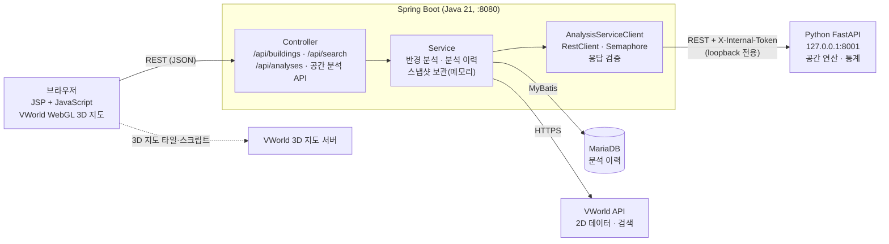
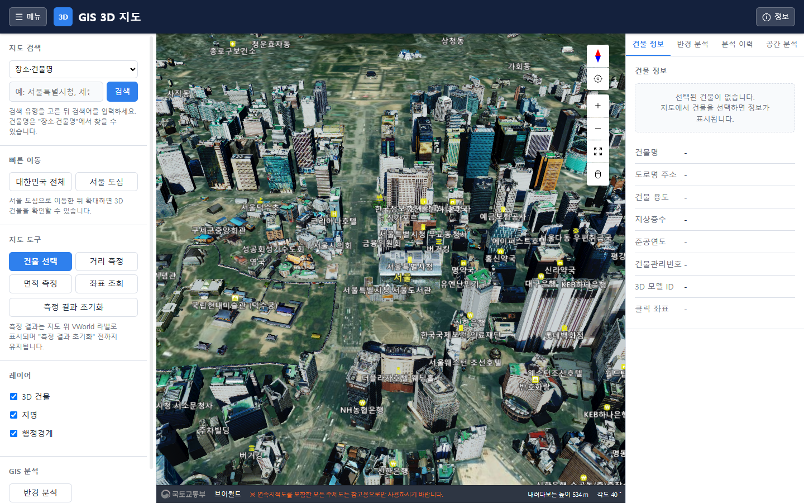
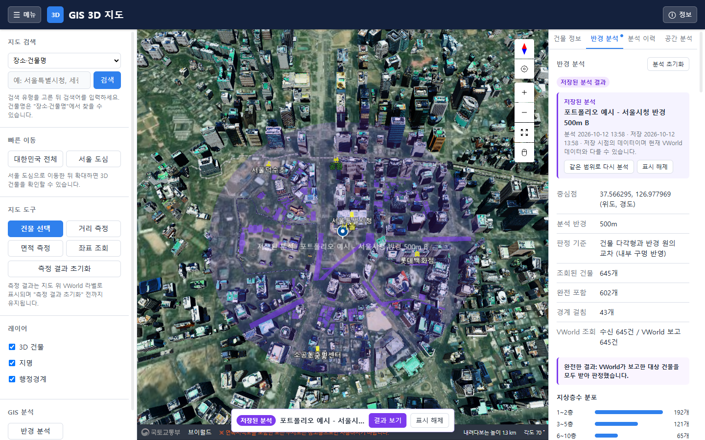
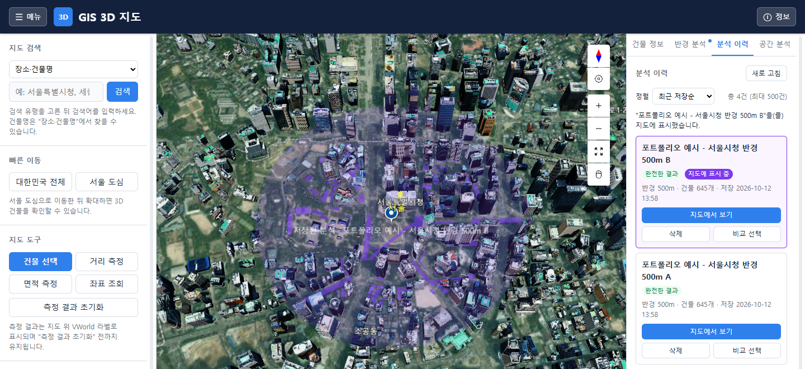
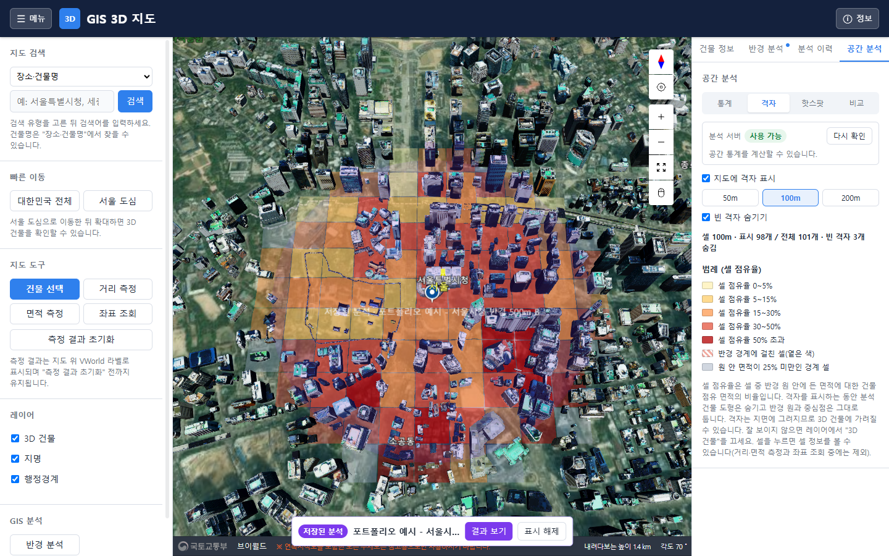
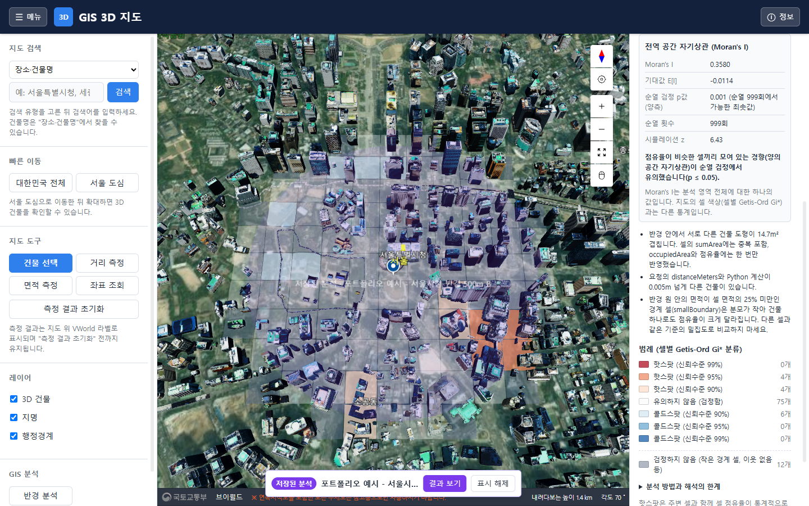
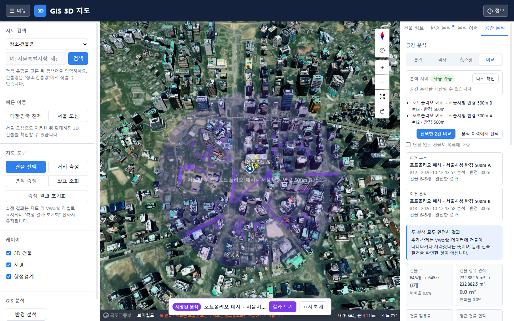

# GIS 3D 지도 — 공간 분석 시스템

VWorld 3D 지도와 Java Spring Boot, Python FastAPI를 연동하여 건물 분포를 조회하고 공간 통계 분석을 수행하는 웹 서비스

---

## 목차

1. [프로젝트 소개](#1-프로젝트-소개)
2. [주요 기능](#2-주요-기능)
3. [기술 스택](#3-기술-스택)
4. [시스템 아키텍처](#4-시스템-아키텍처)
5. [핵심 기술 구현](#5-핵심-기술-구현)
6. [프로젝트 구조](#6-프로젝트-구조)
7. [실행 방법](#7-실행-방법)
8. [테스트 결과](#8-테스트-결과)
9. [주요 화면](#9-주요-화면)

---

## 1. 프로젝트 소개

### 개요

VWorld(국토교통부 공간정보 오픈플랫폼) 3D 지도 위에서 지점과 반경을 정해 그 안의 건물을 조회하고,
건물 면적·점유율·층수 통계, 격자 밀집도, 핫스팟(Getis-Ord Gi\*)과 전역 공간 자기상관(Moran's I)을 계산해
지도와 패널에 보여 주는 웹 서비스입니다. 분석 결과는 MariaDB에 저장해 다시 보거나 두 시점을 비교할 수 있습니다.

### 개발 목적

- 외부 공공 API(VWorld)의 건물 데이터를 서버에서 수집·검증하고 결과의 완전성을 함께 다루는 백엔드 구현
- Java 웹 애플리케이션과 Python 수치 계산 서비스를 분리하고, 안전한 내부 API로 연동하는 구조 설계
- 공간 통계 결과를 신뢰할 수 있는 경우에만 보여 주도록 데이터 품질 규칙을 코드로 강제

### 주요 특징

- **서비스 분리**: 화면·인증 경계·DB·외부 API는 Spring Boot, 공간 연산과 통계는 Python FastAPI가 담당합니다.
  브라우저는 Java API만 호출하며 Python 주소와 내부 토큰은 브라우저에 전달되지 않습니다.
- **장애 격리**: Python 분석 서비스가 꺼져 있어도 지도, 반경 분석, 분석 이력은 동작하고 공간 분석 API만 503을 응답합니다.
  DB가 없어도 애플리케이션은 기동하며 이력 API만 503을 응답합니다.
- **결과 완전성 관리**: 외부 API의 조회 한도·시간 초과 등으로 일부 건물만 조회된 결과는 "부분 결과"로 표시하고,
  핫스팟 통계처럼 부분 데이터로는 왜곡될 수 있는 분석은 계산 자체를 차단합니다.

---

## 2. 주요 기능

| 기능 | 내용 |
|---|---|
| VWorld 3D 지도 | WebGL 3D 지도 API 3.0 기반 지도, 3D 건물·지명·행정경계 레이어 표시 전환 |
| 위치 및 건물 검색 | 장소·도로명 주소·지번 주소 검색(VWorld 검색 API를 서버에서 호출), 3D 건물 클릭 시 건물 정보 조회 |
| 거리·면적 측정 | VWorld 기본 측정 기능을 이용한 거리·면적 측정, 지도 클릭 지점의 좌표 조회 |
| 반경 기반 건물 분석 | 지도 클릭 또는 검색 위치를 중심으로 반경 50 m ~ 1 km 안의 건물 조회, 거리순 목록, 면적·층수 구간 통계, 부분 조회 사유 표시 |
| 분석 결과 저장·이력 관리 | 저장 전 결과를 서버에 임시 보관(토큰)한 뒤 저장, 목록(정렬 4종·페이지), 다시 보기, 삭제 |
| 격자 밀도 분석 | 반경 원을 50/100/200 m 정사각 격자로 나눠 셀별 건물 점유율을 5단계 색으로 지도에 표시, 셀 클릭 상세 |
| 핫스팟 분석 | 셀 점유율에 Getis-Ord Gi\*를 적용해 핫스팟·콜드스팟을 신뢰수준 90/95/99%로 분류, 전역 Moran's I와 순열 검정 결과 표시 |
| 저장된 분석 결과 비교 | 같은 중심·반경으로 저장된 두 분석의 통계 차이와 건물 단위 변화(추가·삭제·변경·유지, 한쪽에서만 관측)를 식별자 신뢰도와 함께 비교 |
| 통계 대시보드 및 시각화 | 분석 서버 상태, 면적·점유율 KPI, 분석 경고, 범례, 셀 상세, 해석의 한계 안내를 한 패널의 보기(통계·격자·핫스팟·비교)로 제공 |

---

## 3. 기술 스택

| 구분 | 기술 |
|---|---|
| Backend | Java 21, Spring Boot 4.0.8 (Spring Web MVC, Validation), Spring `RestClient` |
| View | JSP, Jakarta JSTL, JavaScript (ES5), CSS |
| Database | MariaDB, MyBatis (mybatis-spring-boot-starter 4.0.1), HikariCP |
| Analysis Service | Python, FastAPI 0.143.0, uvicorn 0.54.0, NumPy 2.5.4, Shapely 2.2.0 |
| Map / External API | VWorld WebGL 3D 지도 API 3.0, VWorld 2D 데이터 API, VWorld 검색 API |
| Build / Test | Maven(Maven Wrapper), JUnit(Spring Boot Test), pytest 9.1.1, Node.js 내장 테스트 러너(`node --test`) |

- 프론트엔드는 프레임워크나 번들러 없이 ES5 모듈 패턴(IIFE)으로 작성했고, npm 패키지를 사용하지 않습니다.
  jQuery는 VWorld 지도 로더가 요구해 함께 로드합니다.
- 개발·검증 환경: JDK 21, Python 3.14.8, MariaDB 13.0, Node.js 24 (Windows 10, PowerShell)

---

## 4. 시스템 아키텍처



### Java ↔ Python 연동 구조

- 브라우저는 Java의 공간 분석 API만 호출합니다.
  예: `GET /api/analyses/{id}/hotspot?cellSize=100`, `GET /api/analysis-snapshots/{token}/grid-density`
- Java는 저장된 분석(DB) 또는 저장 전 결과(스냅샷)를 Python 요청 형식으로 변환해
  `POST /internal/v1/{building-stats | grid-density | compare-analyses | hotspot}`을 호출합니다.
- 모든 내부 요청에는 `X-Internal-Token` 헤더가 붙고, Python은 토큰이 없거나 다르면 거부합니다
  (토큰이 설정되지 않은 Python은 내부 API에 503을 응답합니다).
- Python 서비스는 `127.0.0.1`에만 바인딩되고 CORS가 없으며 DB에 접근하지 않습니다.
- Java는 Python 응답을 그대로 전달하지 않고 응답 구조와 불변식을 검증한 뒤
  `{ analysisIds, analysisService: { schemaVersion }, result }` 형태로 브라우저에 반환합니다.

---

## 5. 핵심 기술 구현

### 5.1 Java ↔ Python 서비스 간 API 연동

`spatial/AnalysisServiceClient.java`, `AnalysisServiceProperties.java`, `PythonRequestMapper.java`

- **내부 토큰과 loopback 제한**: Python 주소는 `http(s)`이면서 loopback 주소(`127.0.0.1`, `localhost`, `::1`)일 때만
  사용합니다. 그 밖의 주소가 설정되면 연동 자체를 비활성화해 토큰이 다른 호스트로 전송되지 않게 했습니다.
  토큰은 환경 변수 또는 Git에서 제외된 로컬 설정 파일에서만 읽고 로그·메시지에 출력하지 않습니다.
- **동시 요청 제한**: `Semaphore`로 Python 동시 요청을 2건으로 제한합니다. 자리가 없으면 대기하지 않고
  "분석 서버가 다른 분석을 처리 중"(503)으로 응답해 Java 요청 스레드가 쌓이지 않게 했습니다.
- **타임아웃과 장애 쿨다운**: 연결 1초, 읽기 15초(비교 30초), 상태 확인 2초. Python에 연결하지 못하면
  10초 동안은 새 요청을 바로 실패 처리해 같은 장애에 반복해서 대기하지 않습니다.
- **크기 제한**: 요청 본문 16 MB(비교 32 MB), 응답 64 MB 상한을 Python 서버 설정과 맞췄습니다.
  이력 저장 요청 본문은 서블릿 필터에서 16 KB로 제한합니다.

### 5.2 Python 응답 검증

`spatial/PythonResponseValidator.java`

- 분석 종류마다 응답의 스키마 버전, 필수 필드, 수치 범위, 개수 불변식을 검사합니다.
  예: 핫스팟 응답에서 셀 수 = 격자 셀 수 = 요약 셀 수, 클래스별 셀 수의 합 = 전체 셀 수,
  분류와 z점수 부호의 일치, p·q값 범위, 검정하지 않은 셀은 통계값이 없어야 함.
- 검증에 실패하면 결과를 버리고 "분석 서버 응답 형식 오류"(502)로 응답합니다. 알 수 없는 필드는 무시해
  Python 쪽 필드 추가에는 영향을 받지 않습니다.

### 5.3 MariaDB와 MyBatis 기반 분석 이력 관리

`history/*`, `resources/mapper/AnalysisHistoryMapper.xml`, `db/mariadb/*.sql`

- 테이블 3개: 분석 이력(`gis_analysis_history`), 부분 조회 사유(`gis_analysis_incomplete_reason`),
  분석 건물(`gis_analysis_building`).
- 반경 분석 결과는 저장 전까지 서버 메모리에 토큰으로 보관(최대 10건, 30분)하고, 저장 시 토큰을 받아
  같은 결과가 중복 저장되지 않게 했습니다(토큰 고유 제약).
- 목록은 저장일·제목·건물 수 기준 4가지 정렬과 페이지(기본 20건, 최대 50건)를 지원합니다.
- DB 계정은 개발용·테스트용을 분리하고 각각 `SELECT`, `INSERT`, `DELETE` 권한만 부여합니다.
  테이블은 관리자 계정이 SQL 스크립트로 만들며 애플리케이션은 DDL을 실행하지 않습니다.
- DB가 없어도 애플리케이션은 기동하고(`initialization-fail-timeout=-1`) 이력 API만 503을 응답합니다.

### 5.4 부분 조회 결과 처리와 통계 신뢰성

`analysis/RadiusAnalysisService.java`, `analysis-service/app/services/hotspot.py`

- 반경 분석은 VWorld 2D 데이터 API를 최대 5페이지(페이지당 1,000건), 20초 안에서 조회합니다.
  한도에 도달하거나 응답이 어긋나면 `PAGE_LIMIT`, `TIME_LIMIT`, `PAGINATION_INCONSISTENT` 등의 사유와 함께
  "부분 결과"로 표시하고 저장 이력에도 사유를 남깁니다.
- 핫스팟 분석은 부분 결과(사유 종류와 관계없이)나 Python이 복구할 수 없는 건물 도형이 있는 경우 통계를 계산하지 않고
  `PARTIAL_RESULT_BLOCKED`(HTTP 200)와 차단 사유를 반환합니다. 화면은 이 경우 지도에 아무것도 그리지 않고
  사유와 완전성 정보만 보여 줍니다.
- 검정 가능한 셀이 30개 미만(`INSUFFICIENT_CELLS`)이거나 모든 셀 값이 같으면(`CONSTANT_VALUES`) 통계 대신 안내를 표시합니다.

### 5.5 격자 밀도와 핫스팟 통계 처리

`analysis-service/app/geo/grid.py`, `services/grid_density.py`, `services/hotspot_stats.py`

- **격자**: 분석 중심의 접평면(m)에서 셀 (0, 0)이 중심에 오는 정사각 격자를 만들고, 반경 원과 셀의 교집합 면적을
  해석적으로 계산해 점유율의 분모로 씁니다. 원 안 면적이 25% 미만인 경계 셀은 별도로 표시합니다.
- **Getis-Ord Gi\***: Queen 인접(8방향)과 자기 셀을 포함한 이진 가중치, 정규 근사 양측 p값.
  검정한 셀에만 Benjamini–Hochberg 다중 검정 보정을 적용한 q값으로 90/95/99% 핫스팟·콜드스팟을 분류합니다.
- **전역 Moran's I**: 행 표준화 가중치, 기댓값 E[I] = −1/(n−1) 기준 양측 순열 검정(기본 999회, 고정 시드로 재현 가능).
- 화면에서는 "유의하지 않음(검정함)"과 "검정하지 않음(사유)"을 다른 색과 문구로 구분하고, 분석 한계를 함께 안내합니다.

### 5.6 지도 렌더링 분할과 캐시

`static/js/spatial-grid-renderer.js`, `spatial-grid.js`, `spatial-hotspot.js`

- 격자 셀(반경 1 km·50 m 기준 최대 1,345개)을 `requestAnimationFrame`으로 프레임당 최대 100개씩 나누어 그리고,
  새 요청·취소 시 이전 작업과 도형을 정리합니다. `map.clear()`를 쓰지 않고 자신이 만든 도형만 지웁니다.
- 셀 크기별 응답을 분석당 최대 3개까지 캐시해 셀 크기를 다시 고를 때 재요청하지 않습니다.
- `AbortController`와 요청 번호로 늦게 도착한 응답이 다른 분석이나 다른 화면에 반영되지 않게 했습니다.
- 격자 밀도와 핫스팟 도형은 이벤트(`gis:spatiallayerchange`)로 서로를 꺼서 동시에 표시하지 않습니다.

---

## 6. 프로젝트 구조

```text
gis-analysis-system/
├── pom.xml, mvnw, mvnw.cmd                  # Maven 빌드 (Maven Wrapper)
├── application-local.properties.example     # 로컬 설정 예시 (실제 값 없음)
├── db/mariadb/                              # DB·계정 생성, 테이블 생성, COMMENT 복구 SQL
├── src/main/java/com/example/gis_analysis_system/
│   ├── web/                                 # 컨트롤러, 요청 크기 필터
│   ├── analysis/                            # 반경 분석, 평면 기하 계산
│   ├── history/                             # 분석 이력 서비스, MyBatis 매퍼, 스냅샷 보관
│   ├── spatial/                             # Python 분석 서비스 클라이언트, 요청 변환, 응답 검증
│   └── vworld/                              # VWorld 2D 데이터·검색 API 클라이언트
├── src/main/resources/
│   ├── application.properties               # 설정 (비밀값은 환경 변수로만)
│   ├── mapper/                              # MyBatis XML
│   └── static/{js,css}/                     # 지도·분석 화면 스크립트와 스타일
├── src/main/webapp/WEB-INF/views/index.jsp  # 단일 화면 JSP
├── src/test/java/                           # JUnit 테스트
├── src/test/js/                             # node --test 단위·DOM 통합 테스트
├── analysis-service/                        # Python FastAPI 공간 분석 서비스
│   ├── app/api/                             # 라우터 (/health, /internal/v1/*), 오류 처리
│   ├── app/schemas/                         # Pydantic 요청·응답 모델
│   ├── app/services/                        # 건물 통계, 격자 밀도, 비교, 핫스팟 통계
│   ├── app/geo/                             # 접평면 투영, 격자, 도형 처리
│   └── tests/                               # pytest
└── tools/grid-bench/                        # 격자 렌더링 성능 측정용 개발 도구 (앱에 포함되지 않음)
```

---

## 7. 실행 방법

아래 명령은 Windows PowerShell 기준입니다. macOS·Linux에서는 `.\mvnw.cmd`를 `./mvnw`로,
`.\.venv\Scripts\python.exe`를 `.venv/bin/python`으로, `$env:NAME = "값"`을 `export NAME="값"`으로 바꿔 실행합니다.

### 7.1 사전 설치

- JDK 21
- Python 3.14 (검증 버전 3.14.8)
- MariaDB (검증 버전 13.0)
- Node.js (JavaScript 테스트를 실행할 때만 필요, 검증 버전 24)
- VWorld 오픈 API 인증키 (WebGL 3D 지도 API, 2D 데이터 API, 검색 API 사용)

### 7.2 MariaDB 초기화

관리자 계정으로 `mariadb` 클라이언트를 열어 프로젝트 루트에서 실행합니다. 비밀번호는 파일에 쓰지 않고 세션 변수로만 전달합니다.

```sql
-- 1) DB와 계정 생성: gis_analysis(개발), gis_analysis_test(테스트), gis_app, gis_test
SET @gis_app_password  = '직접 정한 비밀번호';
SET @gis_test_password = '직접 정한 다른 비밀번호';
SOURCE db/mariadb/01_setup.sql
```

```powershell
# 2) 테이블 생성: 개발 DB와 테스트 DB에 각각 실행 (클라이언트가 파일을 직접 읽게 한다)
mariadb -h 127.0.0.1 -u root -p --default-character-set=utf8mb4 --abort-source-on-error gis_analysis -e "source db/mariadb/02_schema.sql"
mariadb -h 127.0.0.1 -u root -p --default-character-set=utf8mb4 --abort-source-on-error gis_analysis_test -e "source db/mariadb/02_schema.sql"
```

- `mariadb`가 PATH에 없으면 MariaDB 설치 경로의 `bin\mariadb.exe`를 직접 지정합니다.
  PowerShell 파이프(`Get-Content ... | mariadb`)는 한글을 깨뜨리므로 쓰지 않습니다.
- `03_fix_comments.sql`은 `02_schema.sql` 실행 중 한글 COMMENT가 깨졌을 때만 쓰는 복구 스크립트입니다.
- 각 스크립트의 머리 주석에 안전 장치와 실행 방법이 자세히 적혀 있습니다.

### 7.3 로컬 설정 파일 준비

```powershell
Copy-Item application-local.properties.example application-local.properties
```

`application-local.properties`(Git 제외 대상)에 값을 넣거나, 같은 의미의 환경 변수를 사용합니다.

| 설정 | 환경 변수 | 설명 |
|---|---|---|
| `vworld.api-key` | `VWORLD_API_KEY` | VWorld 인증키. 없으면 지도 스크립트를 로드하지 않습니다. |
| `vworld.domain` | `VWORLD_DOMAIN` | 인증키 발급 시 등록한 서비스 URL (기본 `http://localhost:8080`) |
| `spring.datasource.password` | `GIS_DB_PASSWORD` | `gis_app` 계정 비밀번호 |
| — | `GIS_DB_URL`, `GIS_DB_USERNAME` | 기본값 `jdbc:mariadb://127.0.0.1:3306/gis_analysis`, `gis_app` |
| `analysis-service.internal-token` | `ANALYSIS_INTERNAL_TOKEN` | Python 서비스와 공유하는 내부 토큰 (양쪽이 같은 값) |
| — | `ANALYSIS_SERVICE_URL` | Python 서비스 주소 (기본 `http://127.0.0.1:8001`, loopback만 허용) |

> 실제 키·비밀번호·토큰은 `application.properties`, 예시 파일, 커밋되는 어떤 파일에도 넣지 않습니다.

### 7.4 Python 분석 서비스

```powershell
cd analysis-service
py -3.14 -m venv .venv
.\.venv\Scripts\python.exe -m pip install -r requirements-dev.txt   # 실행만 할 때는 requirements.txt

$env:ANALYSIS_INTERNAL_TOKEN = "<Java와 같은 임의의 긴 값>"
.\.venv\Scripts\python.exe -m app                                   # 127.0.0.1:8001

# 다른 터미널에서 확인
Invoke-RestMethod http://127.0.0.1:8001/health                     # status: ok
```

Python 서비스의 API와 환경 변수(`ANALYSIS_HOST`, `ANALYSIS_PORT`, 본문 크기 제한 등)는
[`analysis-service/README.md`](analysis-service/README.md)에 정리되어 있습니다.

### 7.5 Spring Boot 실행

프로젝트 루트에서 실행합니다. `application-local.properties`는 실행 위치 기준(`./`)으로 읽습니다.

```powershell
# application-local.properties에 토큰을 넣지 않았다면 Python과 같은 값을 환경 변수로 지정
$env:ANALYSIS_INTERNAL_TOKEN = "<Python과 같은 값>"
.\mvnw.cmd spring-boot:run
```

### 7.6 브라우저 접속

- `http://localhost:8080`
- VWorld 인증키에 등록한 서비스 URL과 접속 주소(`VWORLD_DOMAIN`)가 일치해야 지도가 표시됩니다.
- Python 서비스나 DB가 없어도 페이지는 열리며, 해당 기능만 "사용할 수 없음"으로 안내됩니다.

### 7.7 테스트 실행

```powershell
# Java (JUnit)
.\mvnw.cmd test

# Python (pytest)
cd analysis-service
.\.venv\Scripts\python.exe -m pytest
cd ..

# JavaScript (Node.js 내장 테스트 러너, npm 설치 불필요)
node --test "src/test/js/*.test.js"
node --test tools/grid-bench/grid-bench.test.js
```

실제 DB·Python 서버·VWorld 키가 필요한 연동 테스트는 다음 환경 변수가 있을 때만 실행되고, 없으면 건너뜁니다.

| 테스트 | 필요한 환경 변수 |
|---|---|
| MariaDB 연동 | `GIS_TEST_DB_URL`, `GIS_TEST_DB_USERNAME`, `GIS_TEST_DB_PASSWORD` |
| Python 실서버 연동 | `ANALYSIS_IT_URL`, `ANALYSIS_IT_TOKEN` |
| VWorld 실제 API | `VWORLD_API_KEY` |

---

## 8. 테스트 결과

전체 점검 결과입니다.

| 구분 | 통과 | 건너뜀 | 실패 |
|---|---:|---:|---:|
| JavaScript (`node --test`) | 254 | 0 | 0 |
| grid-bench (`node --test`) | 25 | 0 | 0 |
| Python (pytest) | 488 | 1 | 0 |
| Java (JUnit, 391건 실행) | 360 | 31 | 0 |
| **합계** | **1,127** | **32** | **0** |

- 건너뛴 32건은 실행 환경이 없을 때 자동으로 제외되도록 만든 연동 테스트입니다(통과로 집계하지 않았습니다).
  - Java 31건: MariaDB 연동 15, Python 실서버 연동 11(이 중 2건은 MariaDB도 필요), VWorld 실제 API 5
  - Python 1건: Git에 포함하지 않는 실제 분석 결과 파일이 있을 때만 실행되는 비교 테스트
- JavaScript 테스트는 가짜 DOM과 가짜 VWorld 지도를 사용합니다. 실제 VWorld 렌더링은 브라우저에서 별도로 확인해야 합니다.

---

## 9. 주요 화면

### 3D 지도 메인


### 반경 분석


### 분석 이력


### 격자 밀도 분석


### 핫스팟 분석


### 분석 비교

